# Diagrammes architrace — flux et structures

Tous les diagrammes ci-dessous sont en Mermaid (rendu automatique sur GitHub/Obsidian/VSCode markdown preview).

---

## D1 — Architecture générale d'un agent self-référentiel (Sprint 11.x)

```mermaid
flowchart TB
    subgraph Agent["Agent self-référentiel"]
        Input["Input x<br/>(image / token)"] --> Body["Body (CNN / Transformer)"]
        PrevState["prev_state z[t-1]<br/>(state_dim)"] --> Fusion["Fusion layer"]
        Body --> Feat["Hidden feat<br/>(d_model)"]
        Feat --> Fusion
        Fusion --> Head1["Task head<br/>→ logits / coord"]
        Fusion --> Head2["State predictor<br/>→ z[t] predicted"]
    end
    Head1 --> TaskLoss["Task loss"]
    Head2 --> AuxLoss["Aux loss = MSE(z_pred, current_state)"]
    Observer["Observer (VG-CNN)<br/>render_arch_state → 64×64×3"] -.->|self_state| PrevState
    style Agent fill:#1a1a2e,stroke:#fff
    style AuxLoss fill:#2a4a2a,stroke:#0f0
    style TaskLoss fill:#2a4a2a,stroke:#0f0
```

**Légende.** Le module *Observer* prend une image rendue de l'architecture (poids, gradients) à 64×64×3 et la projette vers `state_dim` dimensions. C'est l'auto-perception. Le `prev_state` alimente la fusion, le `state_predictor` essaie de prédire ce qu'il deviendra → boucle strange-loop Hofstadterienne opérationnalisée.

---

## D2 — Recipe LLM révisé (Sprint 20C InfoNCE)

```mermaid
flowchart LR
    Tokens["Input tokens<br/>x = [t1, t2, ..., tT]"] --> Embed["Token embedding<br/>(vocab → d_model)"]
    Embed --> Transformer["Transformer body<br/>(LoRA fine-tuned)"]
    Transformer --> H["Hidden states<br/>h[t] (B, T, d_model)"]
    H --> LMHead["LM head"]
    H --> StateProj["state_proj<br/>(d_model → 64)"]
    LMHead --> LMLoss["lm_loss = CE(logits, y)"]
    StateProj --> S["s[t]<br/>(B, T, 64)"]
    S --> Predictor["predictor<br/>MLP(64 → 64)"]
    Predictor --> SHat["ŝ[t]"]
    SHat --> InfoNCE["InfoNCE(ŝ[t], s[t+1])<br/>per-token contrastive"]
    InfoNCE --> Total["loss = lm_loss + α·surp<br/>(α=0.1)"]
    LMLoss --> Total
    style InfoNCE fill:#2a4a4a,stroke:#0ff
    style Total fill:#2a4a2a,stroke:#0f0
```

---

## D3 — Comparaison S20D vs S20F (warmup predictor-only vs whole-model)

```mermaid
flowchart TB
    subgraph S20D["Sprint 20D — predictor-only warmup (succès partiel)"]
        L20D["Lorenz coords<br/>(B, T, 3)"] --> P20D["Predictor seul<br/>(64→64)"]
        P20D --> MSE20D["MSE next-step"]
        LLMfrozen["LLM (gelé)"] -. n'apprend rien .-> P20D
    end
    subgraph S20F["Sprint 20F — whole-model warmup (échec)"]
        L20F["Lorenz coords<br/>(B, T, 3)"] --> Coord20F["coord_proj<br/>(3 → d_model)"]
        Coord20F --> LLM20F["LLM body<br/>(LoRA APPREND)"]
        LLM20F --> Head20F["coord_head<br/>(d_model → 3)"]
        Head20F --> MSE20F["MSE next-coord"]
        MSE20F -.->|forgetting partial| LLM20F
    end
    S20D --> Phase2A["Phase 2 : text + InfoNCE<br/>Δ pp = -0.61 (smooth-prior generic)"]
    S20F --> Phase2B["Phase 2 : text + InfoNCE<br/>Δ pp = +0.53 (DÉGRADE)"]
    style Phase2A fill:#2a4a2a,stroke:#0f0
    style Phase2B fill:#4a2a2a,stroke:#f00
```

**Insight.** Quand on apprend à la LLM elle-même à prédire Lorenz (S20F), les LoRA adapters s'alignent sur dynamique chaotique. Phase 2 text doit ensuite défaire ce qu'a appris phase 1 → catastrophic forgetting partial. Quand seul le predictor head apprend Lorenz (S20D), LLM weights restent intacts, et predictor gagne un kernel Lipschitz régularisateur.

---

## D4 — Arbre de décision : quand le recipe self-coherence fonctionne ?

```mermaid
flowchart TD
    Start["Recipe self-coherence<br/>(aux loss prediction internal state)"] --> Q1{Substrat ?}
    Q1 -->|Vision MLP/CNN/Mixer| V1{Task type ?}
    Q1 -->|ViT| V2["Inverse direction<br/>(0.7× speedup)"]
    Q1 -->|LLM language| V3{Aux loss type ?}

    V1 -->|Classification discrete| C1["✓ Recipe marche<br/>S11.x : 8-103× speedup"]
    V1 -->|Smooth regression| C2["? Pas testé"]

    V3 -->|Two-halves MSE α=1| L1["✗ Dégrade<br/>(scale-dependent)"]
    V3 -->|Per-token InfoNCE α=0.1| L2{Pre-train predictor ?}
    L2 -->|Yes, smooth source| L3["✓ Petit modèle<br/>(Δpp -0.6 à 410M)"]
    L2 -->|Yes, smooth source| L4["✗ Grand modèle<br/>(self-bootstrap > help)"]
    L2 -->|No| L5["~ Marginal<br/>(Δpp -0.1 toutes échelles)"]

    Q1 -->|LLM-on-world task| W1["✗ Anti-aligned<br/>S20G : +78% MSE"]

    style C1 fill:#2a4a2a,stroke:#0f0
    style L3 fill:#2a4a2a,stroke:#0f0
    style L5 fill:#4a4a2a,stroke:#ff0
    style L1 fill:#4a2a2a,stroke:#f00
    style W1 fill:#4a2a2a,stroke:#f00
    style V2 fill:#4a2a2a,stroke:#f00
    style L4 fill:#4a4a2a,stroke:#ff0
```

---

## D5 — Compatibilité substrate × task × aux loss

```mermaid
flowchart TD
    subgraph Inputs["Trois axes d'alignement"]
        Sub["1. Substrate geometry<br/>(hidden state manifold)"]
        Task["2. Task structure<br/>(discrete / smooth)"]
        Aux["3. Aux loss type<br/>(contrastive / MSE)"]
    end
    Sub --> Check{Triple alignement ?}
    Task --> Check
    Aux --> Check
    Check -->|All compatible| Win["Recipe efficace<br/>(vision S11.x)"]
    Check -->|2 sur 3| Partial["Effet partiel<br/>(LLM S20C, S20D)"]
    Check -->|1 sur 3 ou moins| Fail["Recipe dégrade<br/>(ViT, S20F, S20G)"]
    style Win fill:#2a4a2a,stroke:#0f0
    style Partial fill:#4a4a2a,stroke:#ff0
    style Fail fill:#4a2a2a,stroke:#f00
```

**Lecture.** L'universalité initiale postulée (Sprint 11.3) supposait un **mécanisme générique**. Les sprints 18C-20G révèlent une **interaction trois-axes**. Le succès vision provient d'un **alignement chanceux** : substrat MLP/CNN flexible × tâche classification discrete × aux loss MSE compatible avec les deux. Modifier UN axe casse le recipe.

---

## D6 — Pipeline générale du projet architrace

```mermaid
flowchart LR
    subgraph Foundation["Fondations (Sprints 1-4)"]
        F1["snapshot.py<br/>58-dim feature vector"]
        F2["bridge.py<br/>Dynamoscope client"]
        F3["predictor_vg.py<br/>ResidualVG"]
        F4["spectral 1/f²"]
    end
    subgraph SelfRef["Self-référentiel (Sprints 5-11)"]
        S1["strange_loop.py<br/>SelfReferentialVG"]
        S2["encoder_vg.py<br/>VGCNNEncoder"]
        S3["arch_to_image.py<br/>render_arch_state"]
        S4["dyadic.py<br/>DyadicAgent"]
        S5["exaptation 103×"]
    end
    subgraph CrossArch["Cross-architecture (Sprints 12-18)"]
        C1["multi_arch_agents.py<br/>ResNet/ViT/Mixer"]
        C2["self_referential_cnn.py"]
        C3["drift normalization S15C"]
        C4["ViT inversion S18C"]
    end
    subgraph LLM["LLM substrate (Sprints 14-20)"]
        L1["scale_1b.py<br/>LoRA pythia"]
        L2["contrastive.py<br/>InfoNCE per-token"]
        L3["world_exaptation.py<br/>predictor-only warmup"]
        L4["llm_world_model.py<br/>whole-model warmup"]
        L5["world_task.py<br/>LLM-on-Lorenz"]
    end
    Foundation --> SelfRef
    SelfRef --> CrossArch
    CrossArch --> LLM
```

